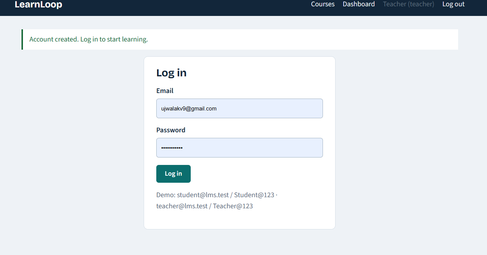

# DEF-001: Password made only of spaces is accepted

| Field | Details |
|---|---|
| Module | Authentication |
| Test case | TC40 |
| Severity | Medium |
| Priority | Medium |
| Status | Open |
| Reported by | Ujwala K V |
| Date | 19-11-2026 |
| Environment | Windows 11, Chrome, Flask app on localhost:5000 |

## Steps to reproduce
1. Open the Sign up page.
2. Enter Name: Test, Email: spaces@test.com, Role: Student.
3. In Password, press the space bar 8 times.
4. Click Create account.

## Expected result
Registration is rejected because a blank password is not a valid password.

## Actual result
The account was created. An all-space password passes the length check of 8 characters.

## Screenshot

