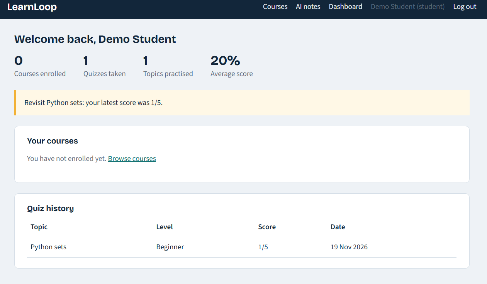

# DEF-003: Quiz is scored against the wrong quiz when two quizzes are open

| Field | Details |
|---|---|
| Module | Quiz system |
| Test case | TC42 |
| Severity | High |
| Priority | Medium |
| Status | Open |
| Reported by | Ujwala K V |
| Date | 19-11-2026 |
| Environment | Windows 11, Chrome, Flask app on localhost:5000 |

## Steps to reproduce
1. Log in as a student.
2. In Tab 1 open /quiz?topic=Python loops.
3. In Tab 2 open /quiz?topic=Python sets.
4. Go back to Tab 1, answer the questions and click Submit answers.
5. Open Dashboard.

## Expected result
The Tab 1 quiz is scored against its own questions and saved under Python loops.

## Actual result
The result page and the Dashboard showed "Python sets", and the score was calculated against Tab 2's questions.

## Screenshot

